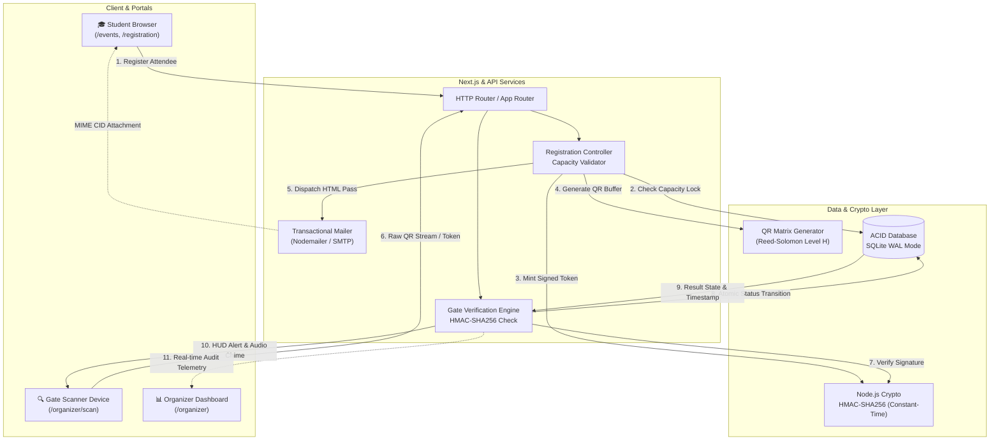

# 📘 CampusPass Technical Handbook & Component Architecture Guide

> **Prepared for:** Web Development Club Induction Project (WEB-04)  
> **Topic:** Event Ticketing System with Automated Mailer and QR Entry Check-In  
> **Author:** Candidate Technical Documentation & Deep-Dive Handbook

---

## 📑 Table of Contents
1. [System Overview & Architecture Diagram](#1-system-overview--architecture-diagram)
2. [End-to-End Workflow & Data Lifecycle](#2-end-to-end-workflow--data-lifecycle)
3. [Cryptographic Security & Anti-Tamper Engine](#3-cryptographic-security--anti-tamper-engine)
4. [Concurrency, Anti-Duplication & Database Integrity](#4-concurrency-anti-duplication--database-integrity)
5. [Transactional Email Dispatch Pipeline](#5-transactional-email-dispatch-pipeline)
6. [Webcam Computer Vision & QR Frame Extraction](#6-webcam-computer-vision--qr-frame-extraction)
7. [Comprehensive Component & File Walkthrough](#7-comprehensive-component--file-walkthrough)
8. [Local Execution & Verification Guide](#8-local-execution--verification-guide)
9. [Club Interview Q&A Preparation Cheat Sheet](#9-club-interview-qa-preparation-cheat-sheet)

---

## 1. System Overview & Architecture Diagram

CampusPass is an enterprise-grade campus event ticketing platform engineered to handle high-throughput student registrations, automated email delivery of cryptographically signed passes, and sub-second gate admission authentication with anti-duplication enforcement.



---

## 2. End-to-End Workflow & Data Lifecycle

The system operates across three distinct phases:

### Phase A: Participant Registration & Capacity Control
1. **Event Discovery**: Students view active events on `/events`. Each event card displays real-time capacity statistics ($C_{\text{registered}} / C_{\text{max}}$).
2. **Atomic Capacity Check**: If $C_{\text{registered}} \ge C_{\text{max}}$, registration is immediately closed and rejected with HTTP `409 Conflict`.
3. **Token Minting**: When capacity is available, the backend generates a cryptographically signed ticket payload.
4. **Digital Pass Display**: The student instantly receives their digital ticket pass on screen with serial number, student ID, and high-contrast QR code.

### Phase B: Transactional Email Dispatch
1. **Dynamic HTML Rendering**: The email engine compiles a branded HTML ticket matching university design standards.
2. **MIME Inline CID Embedding**: The QR code PNG buffer is attached with `Content-ID: <ticketqr>`. This ensures the image renders in Outlook, Gmail, Apple Mail, and mobile clients without external image-blocking barriers.
3. **SMTP Relay**: Transmitted via SMTP credentials (Resend, SendGrid, Brevo, AWS SES, or auto-provisioned Ethereal sandbox).

### Phase C: Gate Entry & Instant Verification
1. **Webcam Video Capture**: The organizer points their phone, tablet, or laptop camera at the student's QR code.
2. **Decoupled Verification Pipeline**:
   * **Stage 1 (Cryptographic)**: Constant-time signature verification. If tampered $\rightarrow$ **`INVALID TICKET`**.
   * **Stage 2 (Database State)**: Atomic check-in state lookup.
     * If first scan $\rightarrow$ State transitions to **`CHECKED-IN`**; check-in timestamp recorded.
     * If already scanned $\rightarrow$ Flagged as **`ALREADY USED`**; original check-in timestamp and attendee identity displayed.
3. **Multi-Sensory Feedback**: High-contrast visual HUD card + Synthesized Web Audio tone frequencies.

---

## 3. Cryptographic Security & Anti-Tamper Engine

### Why Plain Ticket IDs Fail
In naive ticketing systems, tickets store simple identifiers like `TKT-1049`. An attacker can iterate sequentially (`TKT-1050`, `TKT-1051`) or fabricate valid-looking codes.

### The HMAC-SHA256 Token Protocol
CampusPass implements a cryptographically signed token protocol based on **Hash-based Message Authentication Codes (HMAC)** with the **SHA-256** hash function:

$$\text{Token} = \text{Base64Url}(\text{Payload}) \;\|\; \text{"."} \;\|\; \text{Base64Url}(\text{HMAC-SHA256}(K, \text{Base64Url}(\text{Payload})))$$

Where:
* $K$ = Server Private Secret (`HMAC_SECRET`).
* $\text{Payload}$ = Serialized JSON containing:
  ```json
  {
    "eventId": "evt_hacksprint",
    "ticketCode": "TKT-HACK-84920",
    "studentId": "22CS1047",
    "studentEmail": "aarav.sharma@campus.edu",
    "issuedAt": 1792408900000,
    "nonce": "3f8a19bc04d7e21a"
  }
  ```

### Verification & Timing Attack Mitigation
When a QR code is scanned:
1. The token is split at the dot: `[payloadB64, signature]`.
2. The server re-computes:
   $$\text{expectedSig} = \text{HMAC-SHA256}(K, \text{payloadB64})$$
3. **Constant-Time Comparison**: Standard string comparison (`===`) terminates as soon as the first non-matching byte is found, leaking timing differences down to single CPU cycles (allowing side-channel forgery). We enforce **constant-time byte comparison** via `crypto.timingSafeEqual`:
   ```javascript
   const sigBuf = Buffer.from(signature, 'utf-8');
   const expBuf = Buffer.from(expectedSig, 'utf-8');
   if (sigBuf.length !== expBuf.length || !crypto.timingSafeEqual(sigBuf, expBuf)) {
     return { valid: false, reason: 'Cryptographic signature mismatch' };
   }
   ```
If even 1 bit in the student ID, seat number, or signature is changed, the validation fails instantly.

---

## 4. Concurrency, Anti-Duplication & Database Integrity

### Time-of-Check to Time-of-Use (TOCTOU) Prevention
A critical bug in event check-in systems occurs when an attendee shares a screenshot of their QR code with a friend, and both attempt to scan at **Gate A** and **Gate B** at the exact same millisecond.

* **Naive (Vulnerable) Code:**
  ```javascript
  const ticket = db.find(code);
  if (ticket.status === 'CHECKED_IN') return 'ALREADY_USED';
  // RACE CONDITION WINDOW HERE
  db.update(code, { status: 'CHECKED_IN' });
  return 'CHECKED_IN';
  ```
  Both Gate A and Gate B read `status === 'ISSUED'` before either write occurs, resulting in double entry!

* **CampusPass Atomic Mitigation:**
  We use an **atomic conditional update inside an ACID transaction lock**:
  ```sql
  UPDATE tickets 
  SET status = 'CHECKED_IN', checked_in_at = CURRENT_TIMESTAMP, checked_in_by = :gate
  WHERE id = :ticketId AND status = 'ISSUED';
  ```
  * If `changes === 1`: This gate won the race condition. Admission approved.
  * If `changes === 0`: Another gate verified this ticket microseconds earlier. The system queries the freshly committed record and returns **`ALREADY USED`** along with the original check-in timestamp.

---

## 5. Transactional Email Dispatch Pipeline

### Embedded CID Attachments vs. Remote Image URLs
Most web email clients (like Gmail and Outlook) block external images by default (``) to protect user privacy. If a ticket QR code is served externally, the student opens their email at the door and sees a broken placeholder image.

CampusPass solves this using **MIME Multipart/Related CID (Content-ID) Attachments**:
```javascript
const mailOptions = {
  from: '"Campus Events" <tickets@campus-events.edu>',
  to: ticket.attendee.email,
  subject: `🎟️ Entry Ticket Confirmed: ${event.title} [${ticket.code}]`,
  html: `
    <div class="ticket-card">
      <h2>${event.title}</h2>
      
    </div>
  `,
  attachments: [
    {
      filename: `ticket-${ticket.code}.png`,
      content: qrBuffer, // Raw binary PNG buffer
      cid: 'ticketqr'    // Matches src="cid:ticketqr"
    }
  ]
};
```
The QR code is packaged directly inside the email binary stream, rendering immediately on all iOS, Android, and desktop clients without network requests or privacy warnings.

---

## 6. Webcam Computer Vision & QR Frame Extraction

### How In-Browser QR Scanning Works
1. **Media Stream Acquisition**:
   Calls `navigator.mediaDevices.getUserMedia({ video: { facingMode: 'environment' } })` to request the device's rear camera.
2. **Frame Rasterization**:
   The `<video>` stream feeds consecutive frames into an in-memory `<canvas>` element at 15–20 FPS.
3. **Computer Vision & Binarization**:
   Each image frame is extracted as raw `ImageData` ($RGBA$ array).
4. **Pattern Detection & Error Correction**:
   The computer vision engine (`jsQR` / `html5-qrcode`) looks for the 3 distinct square finder patterns in the corners, calculates perspective skew, and applies **Reed-Solomon Level H Error Correction** (allowing up to 30% glare, tear, or screen smudge recovery).
5. **Debouncing & Cooldown**:
   A 3-second cooldown buffer prevents a single stationary badge from triggering 20 duplicate scan events per second.

---

## 7. Comprehensive Component & File Walkthrough

### Backend Layer (`/src`)
* [config.js](file:///Users/vibhajanga/Projects/AWS%20WEB%20DEV/src/config.js): Centralized configuration loader for port, crypto secret, database paths, and SMTP variables.
* [database.js](file:///Users/vibhajanga/Projects/AWS%20WEB%20DEV/src/db/database.js): SQLite database interface initialized in Write-Ahead Logging (WAL) mode. Contains atomic transactions: `registerAttendee` (with capacity lock) and `processTicketCheckIn` (with anti-duplication lock).
* [cryptoService.js](file:///Users/vibhajanga/Projects/AWS%20WEB%20DEV/src/services/cryptoService.js): Cryptographic engine producing and verifying HMAC-SHA256 signatures with constant-time buffer comparison.
* [qrService.js](file:///Users/vibhajanga/Projects/AWS%20WEB%20DEV/src/services/qrService.js): Generates high-recovery QR matrices as Base64 Data URLs and raw PNG buffers.
* [emailService.js](file:///Users/vibhajanga/Projects/AWS%20WEB%20DEV/src/services/emailService.js): Nodemailer engine formatting dynamic HTML passes and embedding CID attachments with Ethereal auto-sandbox support.
* [verify.js](file:///Users/vibhajanga/Projects/AWS%20WEB%20DEV/src/routes/verify.js): API router handling `POST /api/verify/scan` and `POST /api/verify/manual`.

### Frontend Layer (`/Frontend`)
* [Frontend/app/page.tsx](file:///Users/vibhajanga/Projects/AWS%20WEB%20DEV/Frontend/app/page.tsx): Main landing page with hero mockup, 3-step guide, and featured campus events.
* [Frontend/app/events/page.tsx](file:///Users/vibhajanga/Projects/AWS%20WEB%20DEV/Frontend/app/events/page.tsx): Events directory with search, category filtering, and live venue capacity gauges.
* [Frontend/app/events/[slug]/page.tsx](file:///Users/vibhajanga/Projects/AWS%20WEB%20DEV/Frontend/app/events/[slug]/page.tsx): Detailed event overview with sticky registration drawer and capacity enforcement.
* [Frontend/app/organizer/page.tsx](file:///Users/vibhajanga/Projects/AWS%20WEB%20DEV/Frontend/app/organizer/page.tsx): Organizer executive dashboard with 5 KPI statistic cards, capacity overview, and active events table.
* [Frontend/app/organizer/events/page.tsx](file:///Users/vibhajanga/Projects/AWS%20WEB%20DEV/Frontend/app/organizer/events/page.tsx): Event management hub with lifecycle status badges and action shortcuts.
* [Frontend/app/organizer/events/new/page.tsx](file:///Users/vibhajanga/Projects/AWS%20WEB%20DEV/Frontend/app/organizer/events/new/page.tsx): Multi-section form to publish events and define venue capacity ceilings.
* [Frontend/app/organizer/registrations/page.tsx](file:///Users/vibhajanga/Projects/AWS%20WEB%20DEV/Frontend/app/organizer/registrations/page.tsx): Master attendee registry with search, status filters, and pass inspection.
* [Frontend/app/organizer/scan/page.tsx](file:///Users/vibhajanga/Projects/AWS%20WEB%20DEV/Frontend/app/organizer/scan/page.tsx): Live gate scanner with camera viewfinder, reticle HUD, manual token input fallback, and instant demo test buttons.
* [Frontend/app/organizer/check-ins/page.tsx](file:///Users/vibhajanga/Projects/AWS%20WEB%20DEV/Frontend/app/organizer/check-ins/page.tsx): Gate audit trail recording every scan with security rejection reasons.
* [Frontend/app/organizer/events/[id]/page.tsx](file:///Users/vibhajanga/Projects/AWS%20WEB%20DEV/Frontend/app/organizer/events/[id]/page.tsx): Event analytics dashboard with turnout rates, capacity distribution bar, and attendee roster.
* [Frontend/components/organizer/organizer-sidebar.tsx](file:///Users/vibhajanga/Projects/AWS%20WEB%20DEV/Frontend/components/organizer/organizer-sidebar.tsx): Responsive navigation drawer for the organizer portal.

---

## 8. Local Execution & Verification Guide

### Quick Start (Both Services)

#### 1. Backend API & Core Engine
```bash
# In workspace root
npm install
npm test       # Runs the 7 automated integration tests
npm start      # Starts backend API on http://localhost:3000
```

#### 2. Modern Next.js Frontend
```bash
# In /Frontend directory
cd Frontend
npm install
npm run build  # Validates zero-error production build
npm run dev    # Launches dev server on http://localhost:3001
```

### Verified Testing Matrix
1. **Test Capacity Limit**:
   * Navigate to `http://localhost:3001/events`.
   * Observe the "Campus AI Summit" marked as **SOLD OUT (500/500)** with registration disabled.
2. **Test Valid Entry Check-In**:
   * Navigate to `http://localhost:3001/organizer/scan`.
   * Click **[🟢 Test Valid Ticket]** or scan a valid QR pass.
   * Result: Green **CHECKED-IN** banner, chime sound, attendee details displayed.
3. **Test Anti-Duplication Security**:
   * Immediately click **[🟡 Test Duplicate Scan]** or re-scan the same ticket.
   * Result: Amber **ALREADY USED** alert, duplicate scan warning, and original check-in timestamp displayed.
4. **Test Counterfeit Detection**:
   * Click **[🔴 Test Tampered/Counterfeit]**.
   * Result: Red **INVALID TICKET** alert, signature mismatch alert, and security audit log entry created.

---

## 9. Club Interview Q&A Preparation Cheat Sheet

Use these prepared responses to ace your club induction interview:

#### Q1: "How does your system prevent two people from using the same QR ticket at different gates?"
> **Answer:** *"We enforce anti-duplication at two levels: First, each ticket contains a unique token with high-entropy nonces signed via HMAC-SHA256. Second, on the database layer, our check-in query is executed as an atomic conditional update (`UPDATE tickets SET status = 'CHECKED_IN', checked_in_at = CURRENT_TIMESTAMP WHERE id = ? AND status = 'ISSUED'`). Even if two gates scan the same QR code at the exact same millisecond, the database write-lock ensures only one query updates 1 row; the second immediately gets 0 affected rows and returns the `ALREADY USED` status with the first scan's timestamp."*

#### Q2: "Why did you use HMAC-SHA256 instead of an asymmetric signature like RSA?"
> **Answer:** *"For this architecture, the server that issues the ticket is also the authority verifying the ticket (symmetric model). HMAC-SHA256 is computationally lightweight, has zero asymmetric key-exchange overhead, produces compact tokens that fit cleanly inside small QR codes without pixel density bloat, and provides tamper-proof integrity when verified using constant-time comparison."*

#### Q3: "What prevents a student from inspecting the QR code and altering the attendee name or seat number?"
> **Answer:** *"The QR code payload is serialized and appended to a cryptographic hash generated using a private server secret. If an attacker modifies even a single character in the student ID or payload, the recomputed HMAC on the server will not match the attached signature. The server detects this mismatch in constant time and immediately triggers an `INVALID TICKET` alert."*

#### Q4: "Why use CID attachments for emails instead of standard image links?"
> **Answer:** *"Standard `` tags are blocked by default in major email clients like Gmail and Outlook for privacy reasons. By attaching the generated QR PNG as a MIME multipart attachment with a Content-ID header (`cid:ticketqr`), the image is rendered locally by the email client without triggering external content-blocking warnings."*
